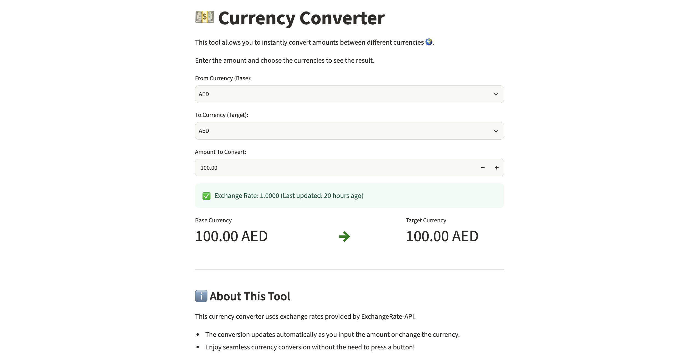

# 💱 Currency Converter

A Python-based currency conversion web application built with **Streamlit** that allows users to convert amounts between different currencies using exchange rates provided by [ExchangeRate-API](https://www.exchangerate-api.com/).

The application features automatic currency conversion, exchange rate caching, and human-readable timestamps showing when exchange rates were last updated.

## ✨ Features

- **Multi-Currency Support:** Convert between a wide range of internationally recognized currencies.
- **Real-Time Exchange Rates:** Retrieve the latest available exchange rates through ExchangeRate-API.
- **Automatic Conversion:** Update conversion results automatically when the amount or selected currencies change.
- **Exchange Rate Caching:** Cache API responses using `cachetools.TTLCache` to reduce redundant HTTP requests.
- **Cache Expiration:** Automatically expire cached exchange rates after three hours.
- **Last Updated Information:** Display exchange rate update times in a human-readable format using `humanize`.
- **Interactive Interface:** Built with Streamlit for a simple and responsive user experience.
- **Input Validation and Error Handling:** Handle unsuccessful API requests and invalid currency selections.

## 🖥️ Application Preview

<!-- Add your application screenshot here -->



## 🛠️ Technologies Used

| Technology | Purpose                                       |
| ---------- | --------------------------------------------- |
| Python     | Core programming language                     |
| Streamlit  | Interactive web application interface         |
| Requests   | HTTP requests and API communication           |
| Cachetools | Caching exchange rate API responses           |
| Humanize   | Formatting timestamps into readable text      |
| Datetime   | Working with timestamps and date calculations |

## 📂 Project Structure

```text
currency-converter/
│
├── app.py                  # Streamlit application and user interface
├── currency_converter.py   # Exchange rate retrieval and conversion logic
├── requirements.txt        # Project dependencies
├── images/
│   └── currency-converter.png
└── README.md
```

## ⚙️ Installation and Setup

### 1. Clone the repository

```bash
git clone https://github.com/alahyarlou/currency-converter.git
```

### 2. Navigate to the project directory

```bash
cd currency-converter
```

### 3. Create a virtual environment

```bash
python -m venv .venv
```

Activate the environment:

**macOS / Linux**

```bash
source .venv/bin/activate
```

**Windows**

```bash
.venv\Scripts\activate
```

### 4. Install dependencies

```bash
pip install -r requirements.txt
```

### 5. Run the application

```bash
streamlit run app.py
```

The application will be available at:

```text
http://localhost:8501
```

## 📦 Dependencies

The project uses the following Python libraries:

```text
requests
cachetools
streamlit
humanize
currencies
```

## 🔄 How It Works

The application follows a straightforward currency conversion workflow:

1. The user selects a base currency and a target currency.
2. The user enters the amount to convert.
3. The application requests the corresponding exchange rate.
4. The caching mechanism checks whether a valid cached response is available.
5. If necessary, the application retrieves updated exchange rate information from ExchangeRate-API.
6. The conversion function calculates the equivalent amount.
7. Streamlit displays the converted amount, exchange rate, and last update time.

### Exchange Rate Caching

To improve efficiency and reduce unnecessary API requests, the application uses `TTLCache` from the `cachetools` library.

```python
cache = TTLCache(
    maxsize=100,
    ttl=300
)
```

This configuration provides:

- Maximum cache capacity: 100 entries.
- Time-to-live: 3 seconds.
- Automatic expiration of outdated cached entries.

The `@cached` decorator makes caching transparent to the exchange rate retrieval function.

## 🧮 Currency Conversion

The conversion is based on the following formula:

```python
converted_amount = amount * exchange_rate
```

Where:

- `amount`: Original amount in the base currency.
- `exchange_rate`: Value of one unit of the base currency in the target currency.
- `converted_amount`: Equivalent amount in the target currency.

## 🚀 Future Improvements

Potential enhancements for future versions include:

- [ ] Historical exchange rate charts.
- [ ] Currency conversion history.
- [ ] Multiple currency conversions in a single operation.
- [ ] Support for additional exchange rate providers.
- [ ] Improved API error handling and retry mechanisms.
- [ ] Unit testing with `pytest`.
- [ ] Automated testing with GitHub Actions.
- [ ] Deployment to Streamlit Community Cloud.
- [ ] Currency search and filtering.
- [ ] More advanced caching and data validation.

## 🎯 Project Objectives

This project was developed to practice and demonstrate practical Python development skills, including:

- Working with external REST APIs.
- HTTP requests and JSON data processing.
- Function design and modular programming.
- Type annotations and documentation.
- Exception handling.
- Caching strategies and performance optimization.
- Building interactive web applications with Streamlit.
- Managing Python dependencies and project structure.

## 👨‍💻 Author

**Ali Alahyarlou**

Python Developer | Interested in Backend Development, Data Science, and Software Engineering.

- GitHub: [Follow Me](https://github.com/alahyarlou)
- LinkedIn: [Contact Me](https://www.linkedin.com/in/alahyarlou/)

---

**Disclaimer:** Exchange rates are provided by ExchangeRate-API and may be subject to update delays. This application is intended for informational and educational purposes and should not be used as the sole source for financial transactions.
